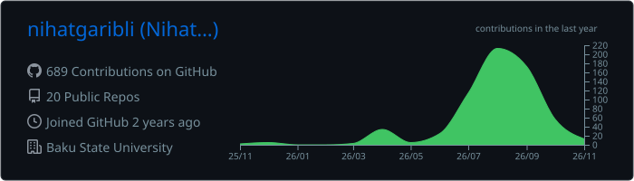
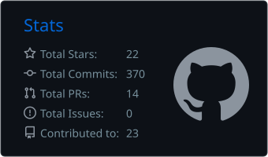
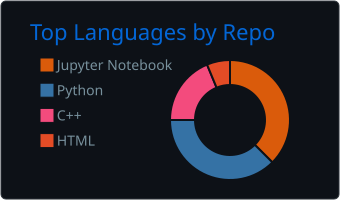

  

  

  
  
  

---

## 👋 About Me

I am an AI researcher and CS student from **Baku, Azerbaijan (Baku State University)** and **Israel, Holon (Holon Institute of Technology)**, working at the intersection of **deep learning and mathematical structure**. My interests span low-resource NLP, computer vision, graph theory and optimization, with a focus on careful evaluation and reproducible results.

- 🔬 **AI Researcher** @ Baku State University
- 🏆 **ICPC Coach** @ Baku State University
- 👨‍🏫 **C++ & Algorithms Instructor** @ Codemy
- 🎓 BSc Computer Science @ **Baku State University**, dual degree with **Holon Institute of Technology** (GPA 94.56)
- 🇦🇿 Building **[AZ-Eval](https://github.com/nihatgaribli/AZ-Eval-benchmark)**, an open parallel Azerbaijani-English LLM benchmark
- 🎯 Open to **research collaborations** and **AI/ML roles**
- 📫 Reach me at **nihatgaribli25@gmail.com**
- 🧾 ORCID: [0009-0003-4755-6356](https://orcid.org/0009-0003-4755-6356)

  
  
  

---

## 🚀 Featured Projects

| Project | What it does | Stack |
|---|---|---|
| [**AZ-Eval**](https://github.com/nihatgaribli/AZ-Eval-benchmark) | Parallel Azerbaijani-English LLM benchmark (1006 human-verified items, 37 models). Shows that fine-tuning on a Cyrillic-script language damages Azerbaijani, while language relatedness predicts nothing | Python · LLM Eval · NLP |
| [**DSF-Net**](https://github.com/nihatgaribli/DSF-Net) | Dual-stream spectral-spatial network for detecting AI-generated images (CIFAKE): 95.71% accuracy, 13.2x smaller than ResNet-18, with a two-run replication study | PyTorch · Computer Vision |
| [**origamicp**](https://github.com/nihatgaribli/origamicp) | Recovering origami crease patterns from images. Mountain/valley is identifiable only up to a global flip; a flip-invariant objective reaches 0.972 up-to-flip accuracy | PyTorch · U-Net · Geometry |
| [**Apar Feedback Routing**](https://github.com/nihatgaribli/apar-feedback-routing) | Multilingual AZ/RU/EN support-ticket routing: TF-IDF baseline to XLM-R blend at 0.9186 macro-F1, CPU-only inference under a 600M-parameter budget | Python · XLM-R · ONNX |
| [**Soccer Tactical Analysis**](https://github.com/nihatgaribli/soccer-tactical-analysis) | Voronoi spatial analytics and an explainable-AI tactical analyst powered by the IBM Granite LLM | Python · LLM · Geometry |
| [**CBAR ETL**](https://github.com/nihatgaribli/cbar-etl) | ETL pipeline for official AZN exchange rates from the Central Bank of Azerbaijan, with SQL analytics and a Streamlit dashboard | Python · PostgreSQL · Docker |
| [**Origami Recognition System**](https://github.com/nihatgaribli/origami-recognition-system) | Scraping, labelling and dataset pipeline for origami images, the foundation for a fold-recognition model (work in progress) | Python · BeautifulSoup |
| [**MNIST Digit Recognition (ANN)**](https://github.com/nihatgaribli/machine-learning-mnist-ann) | Feed-forward neural network built from scratch with manual backpropagation, grid search and 5-fold CV | Python · NumPy |
| [**Data Science from Scratch**](https://github.com/nihatgaribli/data-science-tasks) | Core ML algorithms (K-Means, GMM, SVM) implemented from first principles | Python · NumPy |
| [**Competitive Programming**](https://github.com/nihatgaribli?tab=repositories&q=&type=&language=c%2B%2B) | Solutions across [Codeforces](https://github.com/nihatgaribli/Codeforces), [CSES](https://github.com/nihatgaribli/CSES) and [Eolymp](https://github.com/nihatgaribli/Eolymp) | C++ · Algorithms |

---

## 📄 Publications & Datasets

- **One Bit Per Sheet: Identifiability and Coherence in Crease-Pattern Recovery**. Preprint, SSRN, 2026. [ssrn.com/abstract=7291678](https://ssrn.com/abstract=7291678)
- **AZ-Eval**: a parallel Azerbaijani-English benchmark. Dataset and code, Zenodo. [doi:10.5281/zenodo.22695091](https://doi.org/10.5281/zenodo.22695091)
- **origamicp**: code and data for crease-pattern recovery, Zenodo. [doi:10.5281/zenodo.21848888](https://doi.org/10.5281/zenodo.21848888)

---

## 🏆 Achievements & Highlights

- 🥇 **7+ awards & honors** across competitions and programs
- 💻 **ICPC (Azerbaijan)**: competitor, now coaching the Baku State University teams
- 🤝 **HackerRank Campus Crew** at Baku State University
- 🤖 **Robotex**: robotics competition placements
- 🧪 Hackathon participant with hands-on data-analysis experience

---

## 🧠 Focus Areas

  
  
  
  
  
  

| Track | Toolkit | Signature Work |
|---|---|---|
| LLM Evaluation | Python, Transformers, bootstrap & permutation tests | AZ-Eval: measuring how models lose a low-resource language |
| Deep Learning | PyTorch, TensorFlow | DSF-Net, flip-invariant crease-pattern recovery |
| Vision + Geometry | OpenCV, NumPy | Geometric pattern detection and image analysis |
| Data Engineering | PostgreSQL, Docker, Streamlit | End-to-end pipelines and dashboards |
| Math for AI | Graph theory, probability, linear algebra | Bridging theory with practical AI systems |

---

## 🛠️ Tech Stack

  

---

## 📊 GitHub Analytics

  

  
  

  

---

## 🐍 Contribution Graph

  

---

## 🤝 Connect With Me

  
  
  
  
  
  

  

<i>"Mathematics is not about numbers, equations, or algorithms. It is about understanding." (W. P. Thurston)</i>

